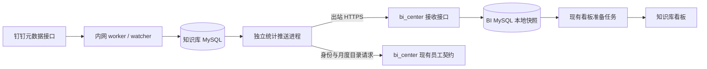

# 内网元数据采集恢复与 bi_center 统计推送实施方案

日期：2026-11-03；2026-11-04 开始实施。原完整设计已独立审查通过；用户补充约束后的增量与数据库负载设计见第 17 节，优先于原全量定时构建描述。

本文落实用户确认的范围：同时恢复钉钉元数据采集和知识库向 bi_center 主动推送统计；AI 自动评审、正文读取和通知继续暂停。用户已于 2026-11-04 授权双端实施、提交合并、部署和验证；正式传输必须在两端均完成提交、合并、部署及检查之后开启。

## 1. 目标、范围和完成判据

1. 公司内网 `10.70.32.32` 是唯一知识库应用运行位置，继续使用既有外部 MySQL。原阿里云知识库应用保持停止。
2. 恢复元数据审计增量和有预算的月度目录校准；补齐暂停期间仍存在且服务身份可见的文件元数据。
3. 知识库通过出站 HTTPS 向 bi_center 推送统计；bi_center 页面和看板准备任务只读自己的数据库，不回访内网。
4. 总览、月度、知识库、员工月度事实来自同一批去重数据；员工部门归属仍由 bi_center 的月度组织契约决定。
5. 重试不重复累计，旧批次不覆盖新批次；断网、重启和看板构建失败保留上一次完整结果。
6. 从可纳入统计的本地元数据提交到 bi_center 常用六个月看板发布，正常情况下目标不超过 15 分钟：等待构建 ≤300 秒、身份预备与构建 ≤120 秒、标脏 ≤30 秒、等待 BI 常用准备 ≤300 秒、构建发布 ≤60 秒，合计 ≤810 秒，预留 90 秒余量。其他已有 1～24 个月范围沿用 BI 每小时低频准备策略，端到端目标 ≤70 分钟。首次补采、身份/源故障等待不计正常延迟，但必须展示具体状态。
7. 不新增评审任务、评审实例、正文下载、模型调用或机器人发送。历史记录保留，不清空原有任务队列，不消费暂停前的任务。

不纳入本轮：修改七部门规则、积分规则、知识库编辑、文档明细跨网传输、批量导入禅道、改变主历史基线、恢复旧云端应用、引入 Redis/MQ。

## 2. 当前依据与必须修补的缺口

设计依据：知识库本地 HEAD `43b1ce336ceb8a83b7791f1afdcf21a98030e4b9`，应用代码发布基线 `a83c1e2`；bi_center 本地 HEAD `28ff68cd8c0621a3a032e4d0ef048d9eb88eb1e2`。实施前重新核对两端正式部署 SHA，不能把本地 HEAD 当作服务器当前版本。

| 位置 | 当前行为 | 本轮要求 |
| --- | --- | --- |
| `app/worker.py`、`app/watcher.py` | 实时审计和月度目录校准已经分进程；当前均暂停 | 保留隔离，恢复采集，不恢复评审/通知 |
| `app/service.py::_upsert_document`、`app/audit_bridge.py::_route_review_event` | 部分入队/到期标记路径没有直接受 `review_enabled` 保护 | 在产生任务或评审标记前统一检查，元数据模式下直接结束 |
| `audit_bridge._try_finish_confirmed` | 上传/修改事件的完成条件含正文适配条件 | 元数据模式确认节点并提交元数据后即完成，不等待正文下载键 |
| `app/audit_pull.py` | 40 分钟重叠、单轮最多 40 页；跨轮仅持久化时间游标 | 持久化固定窗口和双字段分页位置，达到页数上限不能跳过余页 |
| `app/metrics.py`、`app/bi_export.py` | 总览合并基线与实时镜像；员工上传事实仍可能读旧 `uploader_month_stats` | 新推送构建器统一源关系，避免新文件只进入总量、不进入部门 |
| `bi_export._meta` | `asOf` 取最大知识库同步时间，不等于全组织完整采集时间 | 分别记录本地统计时间、审计进度、目录完整校准时间 |
| BI `employee_directory_contract.resolve_employee_identities_batch` | 先检查当前在职，再应用历史月快照 | 增加显式的按事实月份资格分支，默认分支保持其他调用方兼容 |
| BI `services/knowledge_governance.py` | 仍通过 HTTP 拉取旧地址，有五分钟聚合缓存 | 增加 push 数据源，读取本地快照 |
| BI `board_results.py`、`services/prepared_boards.py` | 已有持久化结果、代次控制、原子发布和保留旧结果机制 | 复用，仅使知识库命名空间失效和重新准备 |

项目技能中的通用目录建议不覆盖本项目现行约束：后台操作者使用既有服务身份 UnionID；分页保持现有 `DingtalkClient.list_nodes` 的 30 条上限，不使用历史设计里“100 条一页”的估算。

## 3. 网络与模块职责



图中钉钉箭头表示数据流；所有网络请求均由内网应用主动发起。HTTP 响应通过原连接返回，不需要外网新建连接访问内网。

| 模块 | 职责与边界 |
| --- | --- |
| `worker` | 审计分页入库、单节点定位、元数据更新；无正文和通知副作用 |
| `watcher` | 按既有 `scan_scheduler` 逐库校准、补漏和删除确认；不做高频整组织遍历 |
| 拟新增 `app/bi_snapshot.py` | 纯本地一致性查询、去重、聚合和契约校验；不在读取事务中调用外部服务 |
| 拟新增 `app/bi_push.py`、`app/bi_publisher.py` | 批量预备身份缓存、构建快照、持久化发件箱、重试与接收状态核对；独立进程，避免慢扫描阻塞推送 |
| BI 拟新增接收模块 | 服务鉴权、完整校验、持久化快照、顺序控制、标记知识库看板待重算 |
| BI 既有知识库服务和看板准备模块 | 从本地快照投影查询范围、按月归属组织、发布展示结果；不承担钉钉采集 |

跨仓库协调：本仓库交付发送端和共用契约文档；bi_center 另建对应任务、实现接收/读取/发布衔接。实施时同步相同 `contractVersion`、字段、鉴权方式、错误码、测试样例和发布时间；不能仅部署发送端。本轮不修改 bi_center 文件。

## 4. 数据存储

所有新增时间列使用 UTC `DATETIME(6)`，JSON 时间使用带 `Z` 的 RFC3339；业务月份按 `Asia/Shanghai`。ID 沿用项目区分大小写的字符列。以下表均在各自现有 MySQL，不跨库直连。

### 4.1 知识库数据库

继续使用 `workspaces`、`documents`、`historical_snapshots`、`historical_file_nodes`、`review_instances`、审计事件/扫描任务/调用计数表。历史 `uploader_month_stats` 不删除、不改写、不再作为新推送员工事实的唯一来源。

| 新增或扩展对象 | 列与约束 | 生命周期 |
| --- | --- | --- |
| `documents` 扩展 | `source_creator_key VARCHAR(128)`、`source_creator_kind VARCHAR(16)`：`user_id/union_id/unknown`；`metadata_applied_at DATETIME(6)`，索引 | 保留原始创建人标识用于稳定解析；不把修改人变成上传人；原 `uploader_key` 保持兼容 |
| `workspaces` 扩展 | `metadata_confirmed_at DATETIME(6)`，nullable | 仅可信列表/详情确认名称、ID 后赋值；审计占位行保持 NULL |
| `kg_bi_identity_month` | 联合主键 `(month, identity_kind, source_key)`；`employee_key`、`resolve_status`、`include_official`、`directory_version`、`policy_version`、`resolved_snapshot_month`、`resolved_at`；类型分别为月字符串、短字符串、布尔和时间 | 仅缓存现有 BI 契约的最终结果，不复制七部门规则；不保存姓名、邮箱等新资料 |
| `kg_bi_push_state` | 单行主键 `id=1`；固定 `source_id`、`last_issued_sequence BIGINT UNSIGNED`、`send_blocked_code VARCHAR(64)`、`send_not_before DATETIME(6)`、`send_failures INT`、`workspace_registry_ready_at DATETIME(6)`、最后构建/成功/错误时间及安全错误码 | 同一生产源的序号永久单调；凭证/协议阻断和退避约束整个源，不随新版本或重启清零 |
| `kg_bi_push_outbox` | `snapshot_id CHAR(36)` 主键；`sequence BIGINT UNSIGNED UNIQUE`；`content_hash CHAR(64)`、`request_json LONGTEXT`、`status VARCHAR(16)`、`attempts INT`、`next_attempt_at`、`lease_owner CHAR(36)`、`lease_until`、`created_at`、`acked_at`、`error_code VARCHAR(64)`；索引 `(status,next_attempt_at)` | 快照正文不可变。状态为 `pending/sending/acked/superseded/blocked` |
| `audit_state` 扩展 | `window_start_ms BIGINT`、`window_end_ms BIGINT`、`next_gmt_create BIGINT`、`next_biz_id VARCHAR(128)`、`completed_end_ms BIGINT`；`gap_since_ms BIGINT`、`gap_reason VARCHAR(64)`、`inventory_reconciled_at DATETIME(6)`，均可空 | 与每页审计入库在同一事务提交；历史审计缺口与库存补齐分别记录 |
| `scan_recovery_runs` 与扫描表扩展 | recovery_id CHAR(36) 主键、month CHAR(7)、requested_at/finished_at DATETIME(6)、requested_by VARCHAR(128)、reason VARCHAR(255)、target_workspace_ids_json/prior_tasks_json LONGTEXT；scan_cycles、scan_tasks 各加 nullable recovery_id CHAR(36) | 同月已完成但早于本次恢复时的一次补采记录，保留原状态/尝试数，重复 recovery_id 幂等 |

发件箱保留：最新待发版本、最新 blocked 版本、仍在租约内的发送版本、最近两个已确认版本的完整 JSON。新版本构建完成后，未领取的旧 pending 改为 superseded；终态日志保留 30 天，非保留版本的 JSON 置空。不得删除最后两个成功版本、最新 blocked 或活跃租约。每小时最多清理 1000 行。

### 4.2 bi_center 数据库

| 新表 | 列与约束 | 作用 |
| --- | --- | --- |
| `bi_kg_source_head` | `source_id VARCHAR(64)` 主键；`accepted_sequence BIGINT UNSIGNED`、`accepted_snapshot_id CHAR(36)`、`last_contact_at`、`last_accepted_at`、`refresh_pending BOOLEAN`、`org_version_hash CHAR(64)`、`last_error_code VARCHAR(64)` | 当前完整接收版本和待刷新状态；所有接收事务锁定此行 |
| `bi_kg_snapshot` | 联合主键 `(source_id,sequence)`，`UNIQUE(source_id,snapshot_id)`；`content_hash CHAR(64)`、`payload_json LONGTEXT`、`generated_at`、`received_at`、`metadata_read_at` | 保存原始聚合事实及来源元信息；同版本不可变 |

看板展示继续存入现有 `bi_board_head/bi_board_result` 及既有交付存储，不建立第二套看板发布系统。看板结果附来源序号和快照 ID。

接收快照 JSON 至少保留：head 当前版本、head 前一版本、仍被任一知识库看板结果引用的版本。其他快照满 30 天后按每小时 1000 行清理；序号 head 永不因清理下降。员工月度事实只在服务器保存，浏览器不接收 UnionID。

## 5. 一致的统计源与口径

### 5.1 统一文件集合

新推送构建器不能组合进程全局 `metrics` 缓存和实时 SQL。以下逻辑集合用于首次基线播种和定点变更投影，普通周期不得再次全表构建（见第 17 节）；读取事务中没有 HTTP、身份解析或模型调用。

1. 使用 `metrics.primary_snapshot_id` 选择的既有主基线，不切换基线。
2. 基线文件按 `node_id` 去重。实时镜像只补基线没有的节点；已确认软删除的镜像节点同时排除基线同节点。目录不计文件。
3. 沿用现有“基线优先”的创建时间、创建人、知识库归属口径；移动/改名更新镜像元数据，但本轮不把历史基线归属整体改为实时归属。该限制写入指标说明。
4. 仅纳入 metadata_confirmed_at 非空、is_active=true 的知识库，再排除忽略前缀和现有等级排除配置（默认 `I`）。审计新库 name=id 的占位行不能凭未知库名通过等级筛选；先进入无名称诊断，等可信元数据确认后才纳入。publisher 启动时完整分页读取一次服务身份可见知识库列表，之后每小时复核；遇到新占位库触发有界详情读取，详情不支持时合并为最多每 10 分钟一次的完整列表刷新，全部计入共享额度。未确认/失权不自动当作已删。个人库不得出现在推送名称、事实或浏览器结果中。
5. 同一个逻辑集合同时派生总量、月份、知识库和员工事实，不能从另一个历史扫描快照补入额外文件。
6. 缺少有效创建时间的文件进入库存总量和 `undatedFileCount`，不猜月份。有效带偏移/Z 的 ISO8601 时间先转换北京时间再取日/月；无偏移的 ISO8601 和日期值明确按北京时间解释。其他格式为无日期，不自动猜时间戳单位。新构建器在后台按源时间字符串批量规范化，不能继续用原始字符串前七位替代时区换算；该边界修正在新契约中记录，不改写原始时间列。
7. 月度使用最近 24 个有数据的月份（上传或有效评审），与既有 V2 的查询窗口选择一致。`latestMonth` 为最近可用月；“本月”单独使用北京时间自然月，没数据就为 0，不能把最近有数据月冒充本月。

首个快照的前置条件是可信知识库列表全分页成功，并在一个短事务中确认列表对象、写 workspace_registry_ready_at；列表失败、截断或预算用尽时不写 ready 标记，不构建/发送首个快照，报 workspace_metadata_unready，保留 BI 原看板。后续列表刷新失败保留已确认字段，不批量清空或将全部知识库设为失活。完整列表确实为空时也需要按 6.2 的允许空规则判断，不将接口异常解释为空列表。

日常/批量分类使用同一已过滤文件集合：机器人为批量；同一源创建人标识北京时间同日文件数达到 200，则该源账号该日全部为批量；其他为日常。此处沿用源账号阈值，不因多个账号合并为 UnionID 而改变批量分类。逐月必须满足 `routine + bulk = uploaded`。这修复旧导出从较大范围取批量量再截断的误差，不修改原历史表。

### 5.2 身份与组织

1. 新节点保存 API 语义明确的创建人类型和原值；无法确定类型记录 unknown，不能按姓名、字符串长相猜测身份。已知节点只补缺失创建人，不用后续修改人覆盖。
2. 旧节点优先取同节点主基线 creator 原值，但不能因列名 `creator_user_id` 就认定 UserID：仅当该 snapshot.definition 有已核实的 creator_identity_kind 证据时采用其 user_id/union_id 类型；无证据时通过 BI 权威目录中 UserID/UnionID 别名唯一匹配确认。无基线时，原 uploader_key 也只有唯一权威匹配才可视为 UnionID。一个值匹配不同人的两个身份域时为 conflict，不选优先级；其余保留 unknown，等待后续节点读取或权威解析补齐，不按数字形式猜绑定。新 normalize_node 同样必须保留其接口/字段类型证据，不明确就 unknown。
3. 收集集合中的唯一“月份＋源身份”（同时覆盖上传月和评审月），通过 6.4 的按事实月 `resolve-batch` 扩展分批解析（每批 ≤500、月份 ≤24）；不统一传当前月。缓存写入 `kg_bi_identity_month`。unknown 可提交 identity.sourceId，仅在 BI 新分支用该值精确匹配月度 UserID/UnionID 域，两个域不同人时 conflict；不启用姓名/模糊搜索。
4. 每 10 分钟读既有主数据状态接口；`policyVersion` 或对应月目录版本变化时刷新受影响缓存；版本未变化的结果最长 24 小时复核一次。新身份立即进入下一批。批量预备前后各读一次版本，只有版本相同才将该轮缓存标记可用于构建；版本变化重试一次，仍变化留待下一轮。HTTP/契约失败不是 unmatched，保留旧缓存并阻止生成依赖不完整身份的新快照。
5. unknown、unmatched、ignored、inactive、conflict 等有确定解析结论的身份进入排除数量；只有 `matched && includeInOfficialStats=true` 进入员工事实。同一人多个账号按 UnionID 合并。
6. bi_center 收到正式员工事实后，仍按自己的月度目录检查资格并归属部门/业务组；目录版本变化重新准备结果。2026-06 以前沿用 BI 的 2026-06 历史组织基线，并暴露 `resolvedSnapshotMonth`；2026-06 及以后缺对应快照，构建失败并保留旧看板，不回退当前部门。

### 5.3 质量统计

历史正文评审仅用于已有指标，不产生新评审。对当前文件取最新 `review_scope=full_content` 实例，顺序为 `created_at DESC, review_instance_id DESC`；`metadata_only` 记录仅保留追溯，不进入新质量指标。这是新契约的显式修正，旧 V1/V2 路由保持原语义。

质量月份按评审完成时间换算北京时间。`manualReviewCount` 是 AI 建议待人工审核的数量，不是人工审核通过数量。人工决定仍独立保存，本轮不新增其统计。评分传合计和有效评分数量，避免对已四舍五入的员工平均分再次平均。

所有平均分为空时返回 null；不能显示 0 分。库存覆盖率使用库存文件数为分母；部门区间“评审数/同期上传数”沿用现有指标并明确其两个时间归属不同，不把它称为同一批上传文件的完成率，也不强制截断到 100%。

## 6. 推送契约 v1（新接口，与现有只读导出分离）

生产 `sourceId` 固定为 `kg-internal-production`。不接受调用方任意创建其他源。外部地址：

`https://neoflow-cn.neo-net.com/bi_center/api/internal/v1/knowledge-governance/snapshots`

应用路由是 `/api/internal/v1/knowledge-governance/snapshots`；由既有反向代理处理 `/bi_center` 前缀，不修改内网访问地址或登录回调。

### 6.1 请求

`POST`，`Content-Type: application/json`，`Authorization: Bearer <专用推送密钥>`。禁止重定向自动跟随，HTTPS 严格验证证书。`sourceId` 必须与密钥绑定的配置一致。

| 顶层字段 | 类型与含义 |
| --- | --- |
| `contractVersion` | 固定整数 1；新契约完整校验，不以“大于等于”方式接受未知版本 |
| `sourceId` | 固定字符串，最长 64 |
| `snapshotId` | UUID 字符串；同一版本重试保持不变 |
| `sequence` | 正十进制字符串，范围 1～18446744073709551615，数据库 BIGINT UNSIGNED；避免 JS 大整数丢失 |
| `generatedAt`、`metadataReadAt` | UTC RFC3339；后者为本次一致性读取开始时间，不等于全组织采集完毕 |
| `contentHash` | 64 位小写 SHA256，计算方法见下 |
| `scope` | `timezone=Asia/Shanghai`、`metricVersion=kg-bi-v3`、`maxMonths=24`、`currentMonth`、`baselineId`、`excludedWorkspaceLevels`、`ignoredPrefixes`、`baselineAttribution=baseline_wins`、`allowEmpty=false` |
| `collection` | `auditCompletedThrough`、`lastAuditSuccessAt`、`calibrationMonth`、`calibrationStatus`、`lastCompleteCalibrationAt`、`remainingWorkspaceCount`、`failedWorkspaceCount`、`unresolvedEventCount`、`gapSince`、`inventoryReconciledAt`；时间可 null、数量非负 |
| `identityVersions` | 各事实月的 `directoryVersion/policyVersion/resolvedSnapshotMonth`；不包含部门名称或个人资料 |
| `data` | 下述 summary/monthly/workspaces/employees/diagnostics |

公共质量字段组 `Q`：`reviewedDocumentCount`、`scoredDocumentCount`、`scoreSum`、`passCount`、`manualReviewCount`、`returnCount`。计数为非负整数；`scoreSum` 是保留 4 位小数的十进制字符串，由原始有效分相加，禁止 NaN/Infinity。平均分由合计除以有效评分数量后保留 1 位，四舍五入使用 Decimal ROUND_HALF_UP。

| data 部分 | 行键与字段 |
| --- | --- |
| `summary` | `workspaceCount,totalFileCount,currentMonthNewFileCount,undatedFileCount`、全库存 Q、`currentMonthQuality`（Q） |
| `monthly` | 唯一 `month`；`uploadedFileCount,routineUploadedFileCount,bulkUploadedFileCount`、Q；含上传或质量数据的最近 24 月，升序 |
| `workspaces` | 唯一 `workspaceId`；`workspaceName,fileCount,currentMonthNewFileCount`、Q；按 workspaceId 排序，包含符合范围但文件数为 0 的知识库，workspaceCount 必须等于行数 |
| `employees` | 唯一 `(month,employeeKey)`；`uploadedFileCount,workspaceCount`、Q；按 month/employeeKey 排序，只有本次窗口中的正式事实 |
| `diagnostics` | 每月正式上传、机器人排除、unknown/未匹配/策略排除上传数量；`undatedFileCount`；不包含源用户标识、姓名或失败对象原文 |

库存总览包含正式员工、机器人和未归属文件；员工事实只含正式员工。因此二者不要求直接相等，但每月上传总数必须能由正式上传加互斥排除计数解释。机器人优先归机器人排除，其次 unknown，再按解析结论分类，禁止一份文件重复落多个排除桶。质量分母与上传分母分别核对。

`contentHash`：对 `{contractVersion,sourceId,scope,collection,identityVersions,data}` 使用 UTF-8、`ensure_ascii=false`、键排序、紧凑分隔符、禁止非有限浮点生成规范 JSON 后 SHA256。排除 snapshotId/sequence/generatedAt/metadataReadAt；数组先按上述行键排序，所有集合型 scope 值排序。同一 hash 的已持久化请求可重复发送，不能重写时间或字段。

请求最大 16 MiB UTF-8，不压缩；发送端构建后先检查。接收端流式累计长度，超过返回 413，不能先无限制读入内存。发布前验证最大请求小于代理 body 限制、MySQL `max_allowed_packet` 和 16 MiB，保留至少 25% 余量。若正式数据超限，当前发布不启用发送，需要单独调整契约或限额并复审，不静默截断员工/月份。

### 6.2 接收校验与响应

模型设置 extra=forbid，所有层级明确字段；计数拒绝布尔、负值、小数，月份严格 YYYY-MM，ID 长度上限 128、库名上限 255。分数范围 0～100；scored ≤ reviewed；结论计数合计 ≤ reviewed；scoreSum 在 `[0,100*scored]`；scored=0 时 scoreSum=0。日期有效且不晚于接收服务器时间 5 分钟以上。

同时校验 hash、行键唯一、排序、范围、个人库排除标识、月度日常+批量=总量、知识库库存之和=总库存、当月新增分知识库求和=总览当月新增、每月正式员工上传和+诊断排除=月上传总量。月窗口外库存不强制等于 24 月上传总和。总览质量与逐库质量应相等；员工质量仅是正式员工子集。

合法空快照必须包含所有结构、显式零值及 `collection.calibrationStatus`，不能把异常捕获后包装成空成功。生产已有非空版本而新版本库存为零时，发送端标记 blocked，不自动替换；管理员在确认真实清空后通过本地一次性重建参数 `--allow-empty` 生成带 `scope.allowEmpty=true` 的新版本，接收方仅在该字段存在且校验通过时允许非空→空。默认 scope.allowEmpty=false，列入 hash。

| HTTP | `code` | 调用方行为 |
| --- | --- | --- |
| 201 | `accepted` | 已完整持久化，不代表页面发布；响应含 acceptedSequence、snapshotId、hash、receivedAt、`boardStatus=pending` |
| 200 | `already_accepted` | 同一 source+sequence+snapshotId+hash 已接收，返回该版本确认；更新 last_contact_at，不重复写统计或反复触发重算 |
| 401/403 | `invalid_push_credential/source_not_allowed` | 停止自动发送，blocked，等待配置修正 |
| 404/503 | `push_disabled` | 可重试，但不回退旧地址 |
| 409 | `stale_sequence` | 返回当前 acceptedSequence；旧版本置 superseded，读取状态后生成更高序号的当前统计 |
| 409 | `snapshot_conflict` | 同序号或同 snapshotId 内容不一致；blocked，不能改旧请求绕过 |
| 413/422 | `payload_too_large/invalid_snapshot` | blocked，返回字段路径和安全错误码，不回显请求值 |
| 429/5xx/超时 | `busy/temporary_failure` | 按重试规则原样重发；超时不能当作未接收 |

序号比较前先检查已有完全一致的版本：已确认旧版本重试即使 head 已更新，也返回 already_accepted；不存在且序号小于等于 head 才返回 stale。相同 snapshotId 换序号始终 conflict。

### 6.3 状态核对

`GET /api/internal/v1/knowledge-governance/status`，使用同一专用推送凭证，仅返回固定源：acceptedSequence、acceptedSnapshotId、contentHash、lastContactAt、lastAcceptedAt、六个月看板已发布来源序号/版本/时间、最近安全错误码和 refreshPending。未收到任何批次时 acceptedSequence="0"。不返回员工事实或密钥。

知识库每次启动和每 10 分钟轮询一次；正常发送成功后无需立即重复请求。用于识别丢失确认、恢复后序号落后及“接收成功但页面未更新”。

### 6.4 身份契约的最小兼容扩展

沿用 BI `POST /api/internal/v1/employee-identity/resolve-batch` 及既有员工目录凭证。每个 items 元素增加可选 `eligibilityBasis`：省略或 `current` 完全走原逻辑；只有 `sourceSystem=dingtalk_knowledge_governance` 可指定 `fact_month_v1`，且必须有有效 monthKey。其他来源使用此值返回该 item 的 validation_error，不改变原调用方行为。

fact_month_v1 的输入 identity 严格为 `userId`、`unionId`、`sourceId` 三者之一的非空字符串（≤128），拒绝多种身份同时传入。本分支只做精确匹配及既有人工绑定/排除政策，不调用钉钉、不按姓名猜测。处理顺序固定：

1. 从 BI 本地该事实月的 UserID/UnionID 索引、正式绑定策略确定目标 UnionID；sourceId 同时检查两域，命中不同员工为 conflict，完全无命中为 unmatched。不能先由当前在职状态否定目标。
2. 先执行适用于该来源/月份的人工排除策略；再按该月快照的在职、组织冲突及正式统计资格判断。当前已离职但事实月有效的员工仍可 matched。当前目录不在职不得抢先覆盖月度结论。
3. 2026-06 前按现有历史基线定位；2026-06 后缺整月快照为 snapshot_missing；该月无此员工为 inactive。人工绑定仅决定目标身份，不自动造月度组织；既有 bind_historical_employee 的老调用行为仍保留在默认分支，新分支同样需要已存在的月度组织依据。
4. 返回每项 index、matched、employeeKey、status、includeInOfficialStats，增加 eligibilityBasis、requestedMonth、resolvedSnapshotMonth、directoryVersion、policyVersion；既有显示字段可兼容返回，但知识库新缓存只保存 4.1 所列字段。matched=true 仅在 includeInOfficialStats=true 且目标月资格通过时成立。
5. status 枚举：matched、unmatched、inactive、ignored、unassigned、conflict、snapshot_missing、error。snapshot_missing/error、缺回包项、重复 index、版本不一致不是正常排除，整轮身份预备失败，保留旧快照重试。

BI 新增 GET knowledge-governance/status 响应的 capabilities.identityFactMonthV1=true 表示扩展已发布。知识库上线前必须确认能力；不支持时不启用新 publisher，不能偷偷回退 current 口径。该扩展和接收接口需在 BI 同次发布，单独补历史离职/别名冲突测试。

### 6.5 嵌套结构和响应冻结

本节补齐 6.1 表中嵌套类型。所有字段必填，不提供隐式默认；允许 null 的字段在此明确列出。JSON 数量类型为 0～9007199254740991 的整数，不接受 bool；统计计数与 sequence 分开处理。

- scope：timezone、metricVersion、baselineAttribution 为上述固定字面量；maxMonths 固定 24；currentMonth 为 YYYY-MM；baselineId 非空字符串≤64（不存在主基线时为 `none`）；excludedWorkspaceLevels 为去重升序的 C/D/P/I 字符串数组；ignoredPrefixes 为去重升序非空字符串数组（每项≤128）；allowEmpty 为 boolean。接收源配置固定要求排除 I，不能由请求自行取消个人库排除。
- collection：auditCompletedThrough、lastAuditSuccessAt、lastCompleteCalibrationAt、gapSince、inventoryReconciledAt 为 UTC 时间或 null；calibrationMonth 为 YYYY-MM 或 null；calibrationStatus 为 not_started/running/completed/completed_with_errors/budget_exhausted/expired/unconfigured/no_targets 之一；三个 Workspace/Event Count 为非负整数。gapSince 表示不可恢复审计历史的最早缺口，inventoryReconciledAt 单独说明当前库存何时补齐。
- identityVersions 是数组，每项仅有 month、directoryVersion、policyVersion、resolvedSnapshotMonth；month/resolvedSnapshotMonth 为 YYYY-MM，版本字符串非空≤128；month 唯一升序，与 monthly 的月份集合相同。无月度数据时为空数组。
- summary/currentMonthQuality/monthly/workspaces/employees 的 Q 全部展开为 6.1 定义的六个质量字段；没有质量记录也必须显式给 0、`scoreSum="0.0000"`。没有上传但有评审的员工行 uploadedFileCount/workspaceCount 为 0。
- diagnostics 仅有 undatedFileCount、unconfirmedWorkspaceCount、monthly；monthly 为按月升序数组，每项仅有 month、officialUploadedFileCount、robotExcludedFileCount、unknownIdentityFileCount、unmatchedIdentityFileCount、policyExcludedFileCount，与 data.monthly 月集合相同。已过滤的个人/忽略库不进入这些上传桶；未确认库只计库数，不传名称。文件分桶顺序：机器人→正式 matched→明确策略/冲突/不在职排除→unknown 类型未命中→其余 unmatched，每份只入一个桶。
- 每个集合缺行代表该范围没有该对象，不能用 null 代替数组；库存知识库集合包含零文件库。workspaces 名称不得有个人库前缀；其他身份值仅允许 opaque employeeKey，未知字段直接拒绝。

所有 POST/GET 服务响应使用以下 envelope；处理器及该路由的校验异常统一适配，不能一端返回 FastAPI 默认 detail、另一端猜 code。

成功：`{ok:true,code:"accepted|already_accepted|status",data:{...},error:null}`。

POST data 仅含 sequence（本次请求序号字符串）、snapshotId、contentHash、acceptedSequence（当前 head 序号）、receivedAt（该请求最初落库时间）、boardStatus（pending/published）。发送端核对 sequence/snapshotId/contentHash，不要求 acceptedSequence 等于本次 sequence（旧版本的幂等确认可能返回更高 head）。published 只在六个月结果已采用该序号时返回，否则 pending。

GET data 仅含 sourceId、acceptedSequence、acceptedSnapshotId、contentHash、lastContactAt、lastAcceptedAt、refreshPending、lastErrorCode、capabilities、board。未接收时两个 ID/hash/时间为 null、acceptedSequence="0"；lastErrorCode 可 null。capabilities 仅含 identityFactMonthV1 布尔值。board 仅含 rangeMonths=6、sourceSequence、snapshotId、revision、publishedAt、status；无发布时前四个版本/时间值为 null，status=unavailable；其余 status 为 pending/published/error。sourceSequence 有值时为正十进制字符串。

错误：`{ok:false,code:<6.2的错误码>,data:null,error:{fieldPaths:[],acceptedSequence:null,retryAfterSeconds:null}}`；fieldPaths 是安全字段路径字符串数组（≤20 项，每项≤128），不含值；stale_sequence 时填 acceptedSequence；临时限流时可填非负 retryAfterSeconds 并带 Retry-After，其他为 null。鉴权错误不返回字段路径或当前 head。

合成 POST 确认示例（HTTP 201）：

```json
{"ok":true,"code":"accepted","data":{"sequence":"7","snapshotId":"11111111-1111-4111-8111-111111111111","contentHash":"aaaaaaaaaaaaaaaaaaaaaaaaaaaaaaaaaaaaaaaaaaaaaaaaaaaaaaaaaaaaaaaa","acceptedSequence":"7","receivedAt":"2026-11-03T08:00:00Z","boardStatus":"pending"},"error":null}
```

合成序号过期示例（HTTP 409）：

```json
{"ok":false,"code":"stale_sequence","data":null,"error":{"fieldPaths":[],"acceptedSequence":"8","retryAfterSeconds":null}}
```

## 7. 构建、发送、并发与恢复

### 7.1 统计构建

1. 独立 publisher 每 300 秒调度一次增量分区构建；启动后首轮立即检查。用 MySQL `GET_LOCK('kg_bi_snapshot_build',0)` 保证同源只有一个构建者，连接生命周期持锁；锁忙跳过，不排重复任务。普通周期使用第 17 节的投影/预聚合，不读取源大表。身份预备+构建总截止 120 秒，超时不发布；SQL 每句沿用 15 秒上限，读取只流式处理必要标量，不加载全量 Document ORM 对象或正文。
2. 在只读事务前确认 workspace_registry_ready_at，完成身份状态检查和批量预备。读取事务发现集合中新身份尚无确定缓存结果时，结束本轮，补解析后重试一次；仍有变化则等下一轮，不能发布半份员工结果。
3. 在一致性读取事务中生成完整结果和诊断，绕过页面缓存；全部成功后结束读事务，校验并计算 hash。
4. 若最新可用 outbox hash 相同，复用原请求；该行已 acked 时，在到达下个 300 秒发送周期且 source 允许发送后条件更新为 pending，以同版本重发更新通信时间。pending/sending 保持原领取/退避状态，blocked 不因同 hash 自动解除。hash 改变时短写事务锁 push_state，分配 `max(last_issued_sequence,最近状态返回acceptedSequence)+1`，生成 UUID，写不可变 JSON、pending 和新序号，一起提交；source 级阻断/退避保持不变。
5. 获取不到远端状态不妨碍本地构建；序号冲突由接收端明确拒绝，再按状态核对重建新版本。序号溢出直接 blocked。
6. 构建失败不修改旧 outbox，不生成空快照；记录错误类型/阶段/码。下一轮重新构建。

### 7.2 发送

发送循环每 5 秒检查一次。领取前必须检查 source.send_blocked_code 为空且 now>=send_not_before；锁 source 状态后确认没有未过期的 sending，再用条件 UPDATE 领取最新可发送 pending，生成 lease_owner，租约 120 秒；同源最多一个有效在途发送。领取后提交，再进行 HTTP，不跨网络持有数据库事务。HTTP connect=5 秒，read/write=30 秒，另设整个请求 45 秒的总截止，不跟随重定向。

成功确认必须匹配本地 snapshotId、sequence、hash；之后在短事务中凭 lease_owner 标记 acked。所有成功/失败对 outbox 和 source 状态的更新均需仍持有该有效 lease_owner；过期持有者不能修改全源阻断/退避。确认不匹配按协议错误 blocked，不伪造成功。新版本出现时，不再发送未领取的旧 pending；已经发出的旧请求允许完成，由接收端序号规则处理。

失败退避 30、60、120、300、600 秒，之后每 600 秒重试，叠加 0～10% 抖动；429 有 Retry-After 时取较大值，上限 3600 秒。失败事务同时写版本状态和 source.send_failures/send_not_before；新版本不能提前突破等待。一次正确确认才清失败次数。401/403/409 conflict/413/422 同时设置 source.send_blocked_code，之后新 pending 不发送；每 10 分钟只读一次状态。

恢复转换：远端 acceptedSequence 小于本地最新已确认序号时，将该保留版本从 acked 条件改回 pending，原 UUID/序号/请求不变；远端 head 更高或收到 stale_sequence 时，旧版 superseded，并设置本轮 force_new_sequence=true，绕过同 hash 复用，按远端序号上界生成新 UUID/序号。快照恢复不修改已有请求。

拟提供本地受控 CLI `python -m app.bi_publisher retry --snapshot-id <UUID> --reason <非空说明>`：要求容器内执行用户为部署管理账号；鉴权配置错误修正后清 source 阻断并恢复该版 pending；422/413/冲突类不能原样释放，必须用 `rebuild --reason ...` 重新校验并分配新版本，校验成功才清阻断。重启不自动清数据库里的阻断。`rebuild --allow-empty --reason ...` 才能设置允许空标记，禁止普通网页用户调用。

租约过期的 sending 在条件 UPDATE 下回 pending，进程被杀不会丢请求；多实例只能一个领取成功。构建和发送锁独立，旧请求超时不会阻止生成新统计。清理不影响活跃租约。

### 7.3 接收事务

1. 鉴权、大小限制、JSON/schema/hash 校验在写事务外完成。
2. 事务中创建或锁定唯一 source head；按 6.2 检查重复、冲突、顺序。
3. 新版本插入 snapshot，更新 accepted head、接收时间和 refresh_pending=true；同一事务提交后才返回 accepted。
4. 不在接收请求内构建图表、不调用知识库、不解析新员工、不拉取钉钉。
5. 并发接收以 head 行锁串行比较，确保仅向更高序号前进；失败回滚全部写入。

## 8. 恢复元数据采集

### 8.1 强制元数据模式

新增 `KG_METADATA_ONLY=true`，默认 false；生产采集恢复必须显式 true。启动校验：metadata_only=true 与 review_enabled、notify_enabled、stream_enabled、model_allow_content_transfer、content_extract_enabled 任一 true 冲突时失败退出。

在以下所有入口落实同一条件，不仅依赖 worker 主循环：`_upsert_document`、`_route_review_event`、评审到期标记、收割器、任务处理器、手动重评 API、正文适配器入口、机器人发送入口。元数据模式下：

- 元数据正常入库；不新增 ReviewJob，不写 review_due_at/dirty_since，不读取正文，不创建 ReviewInstance。
- 已有评审任务、到期标记和通知行原样保留，不消费、不清理、不重新激活。
- confirmed 的上传/修改审计事件在节点元数据成功提交后终态为 `metadata_applied_review_paused`；不要求下载键，不触发补评。
- 原 `audit_review_since/review_since` 只约束评审，不得阻止本轮可获取事件的元数据更新。
- 审计静默告警不通过机器人发送（`KG_AUDIT_ALERT_USER_ID` 置空且发送入口检查 metadata_only）；错误在管理诊断和本地日志展示。

将单节点/逐库采集中的逐文档 BI 解析移到独立批量身份预备流程。节点原始身份先持久化；bi_center 短暂不可用不回滚整库采集。既有页面需要的 EmployeeMap 仍按既有后台身份同步维护，但不能作为新 BI 月度事实的当前部门替代。

### 8.2 审计增量

维持现有审计每 600 秒、定位每 30 秒、最多 3 次、10/20 分钟退避；沿用数据库 HTTP 调用计数。禁止定位失败后横扫全部知识库。

固定窗口分页：无活跃窗口时建立 `[max(completed_end-40分钟, now-24小时), now]`；首次无进度从 now-40 分钟开始。保存窗口起止。每页使用现有 API 的 nextGmtCreate+nextBizId；每页最多 500，单轮最多 40 页。

升级时不把旧 `last_gmt_create` 当作新完整窗口水位：新增 completed_end/window/双游标列均从空开始，旧列仅保留诊断。首次 gap_since_ms 取旧 last_run_at 与当前窗口起点较早者（旧值为空则取恢复时间与起点较早者），从上述浅窗口开始。后续最早缺口只取 min，不向后覆盖。活跃窗口 window_start 早于 now-24 小时时，先持久化 gap 与 expired_window 原因，再结束该过期窗口并从 now-24 小时开新窗口；不能永久重试不可回看的旧页。完整目录补采只更新 inventory_reconciled_at，表示当前库存已校准，不清除已不可恢复的审计历史 gap。

- 每页写入去重审计事件和下一双游标，在同一事务提交；重复键沿用 `_audit_event_key`。
- 页数上限、进程中断、HTTP 失败：保留固定窗口和下一页位置，下轮继续，不将 completed_end 推到窗口末尾。
- 返回不足 500 条才视为当前窗口已遍历；事务推进 completed_end=window_end，清除窗口分页位置。满页即使是最后一页，也再请求空页确认结束。
- 分页位置不前进或回退：标记 `audit_cursor_stalled`，保留进度，停止当轮，不能无限循环或跳页。
- 暂停/断网超过可回看范围：设置 gapSince，不谎报已补齐，安排目录校准补当前仍存在的节点；暂停期间已删除且无审计记录的历史操作不能重建。
- 元数据模式忽略读取操作的日聚合，不把重叠窗口重复读取次数用于本轮看板；本轮不推访问次数。

事件定位仅接受确证 nodeId，不以同名文件直接确认为节点。未定位事件保留诊断并按现有死信策略结束；已有时间滞后和原生文档事件覆盖不足由周期校准补漏。

### 8.3 首次补采和月度校准

使用现有 `scan_scheduler`，监控范围保持当前 `KG_WATCH_WORKSPACES` 和忽略配置；`*` 表示服务身份可见范围，不声称整个企业所有知识库。初次上线明确触发本自然月一次 `force=True` 校准，不等到 10 日；持久化同一个 `scan_cycles[YYYY-MM]`，当月 10 日不再跑第二轮。

实施前按历史目录结构计算 `Σ max(1,ceil(每目录子节点数/30))` 加知识库列表、token 和重试余量（20%）的调用估算，与当月/当日/节点接口剩余额度取最小可用值比较。估算不满足时，不开启无界扫描；记录 `budget_insufficient`，保留审计和既有数据，明确列出完成不了的库及所需额度，由用户决定调整预算或范围。

每次最多一个知识库，成功库不重复；失败库按现有最多 3 次重试。容器重启只接续未完成库，不重开整组织校准。首次已存在终态周期时，按以下规则执行：若本月完整成功时间晚于本次恢复请求时间，直接复用；否则在预算核对通过后，管理员创建唯一 recovery_id 和目标库列表，在 scan_recovery_runs 保存原 cycle/task 状态与 attempts，再将指定目标库改为本次 recovery 的 pending、attempts=0、cycle=running。即使旧任务 succeeded，也允许为本次暂停缺口重新采一次；每个目标在该 recovery 内成功后不重复。旧 dead_letter 的 3 次限制不跨 recovery 重置成无痕重试：新一轮也最多 3 次且保留此前完整记录。重复同 recovery_id 只继续未完成项，不能重复重置；正常月度调度仍只有一个周期，不自动创建第二次 recovery。预算不足不发起 recovery，不删除周期或伪造月份。

本次恢复默认目标是恢复时可信列表中全部未忽略的监控库。若管理员仅选择部分库补采，不能据此推进全范围 lastCompleteCalibrationAt/inventoryReconciledAt；这两个时间只在被冻结目标清单全部成功、无权限/预算失败，且每个成功扫描开始时间均不早于对应恢复请求时推进。旧周期先前的成功不能冒充本次全范围补齐。

逐库继续保持完整遍历事务：完整成功才更新该库完整采集时间、播种完成状态和缺席计数。失败回滚，不更新“完成时间”。目录缺席连续两次完整成功校准才软删除；扫描失败、权限错误、截断页和预算耗尽均不算缺席。初次补采不能直接将所有未见节点删除。

为避免慢扫描覆盖并发审计的新元数据，扫描开始从数据库取 UTC_TIMESTAMP(6) 作为 scan_started_at；更新或缺席处理以 `metadata_applied_at IS NULL OR metadata_applied_at <= scan_started_at` 为条件，数据库 UPDATE/UPSERT 条件在锁定当前行后判定。扫描成功更新写 scan_started_at；审计更新写本事务数据库 UTC_TIMESTAMP(6)。迁移旧行保持 NULL，直到真实采集或有来源依据的回填，不用迁移执行时间冒充采集时间。扫描提交后才到达的审计正常覆盖扫描。扫描中出现插入冲突按 nodeId 重新读取并应用同一条件，不能让整个知识库因一个新节点失败。

周期校准保持每月 10 日一次，不新增每日全组织扫描。审计不能覆盖的新增/修改，最迟由下一次成功校准发现；因此“本地入库后 15 分钟”不等于“所有钉钉变化 15 分钟内入库”。新库由每次完整知识库列表发现并纳入后续任务；权限范围外数据不承诺采集。

## 9. bi_center 看板接入与缓存衔接

新增 `KNOWLEDGE_GOVERNANCE_SOURCE_MODE=pull|push`，默认 pull 以兼容其他环境；正式内网来源切为 push。push 模式不要求旧 BASE_URL/API_KEY 配置，也不允许失败回退旧地址。浏览器原 dashboard URL 和原展示字段继续兼容。

1. 知识库服务构建器在 BOARD_BUILD 上下文读取 accepted snapshot 一次，并固定该 source sequence；同一次计算不得跨版本读取。
2. 从完整 24 月事实中投影请求的 1～24 可用月份；总览与知识库库存不随窗口裁剪，部门统计仅聚合选定月份。按照 scoreSum/scoredDocumentCount 计算加权平均。
3. 月度组织使用 BI 本地契约结果；确定为非正式/未归属的员工进入汇总诊断，不出现在浏览器个人列表。对应月快照缺失或目录读取异常必须抛出构建失败，不能吞异常返回空部门。
4. 增加 sourceSnapshotId/sourceSequence、统计生成时间、采集状态、最后完整校准时间和组织基线说明；浏览器仅获得聚合及安全时间信息，不获得 employees/UnionID。
5. 接收事务只设置 refresh_pending。既有 BI 后台周期增加最多每 30 秒一次的该源检查：固定本轮 `(accepted_sequence,org_version_hash)`，仅对 `knowledge_governance` 命名空间标脏，并清理其旧五分钟源缓存；完成标脏后仅在这两个值均未变化时清 refresh_pending。组织版本相同序号内发生变化也必须保留新通知。崩溃重试标脏允许重复，不能漏掉事务已接收的数据。
6. 上述每 30 秒检查还从 BI 本地状态读取当前快照涉及各月的目录版本及 policyVersion，按月排序后算 org_version_hash；与 source head 不同则在短事务更新 hash 并置 refresh_pending，再走同一标脏流程。缺月状态也计入 hash，补齐后可触发恢复。不能只等待知识库下次产生上传变化。
7. 复用现有 generation 检查；知识库看板发布事务先锁 `bi_kg_source_head`，再按既有顺序锁看板 head，在事务内比较构建固定的 source sequence 和 org_version_hash；changed 和 unchanged 两条提交分支都检查，已过期则不发布，安排下一轮。接收只锁 source head、不同时锁看板 head，避免锁序反转。新接收后尚未来得及标脏的窗口，也不能让旧快照覆盖新结果。
8. 构建失败保持上一次完整结果，记录错误和待重试；无成功结果时返回明确 data_unavailable，不返回 ready+全零。常用六个月结果五分钟准备，其他范围最多一小时；不因每次推送把所有历史范围改成高频。

展示状态分别表达：服务通信是否正常、源采集是否完整、看板采用哪个版本。连续 30 分钟无成功接收显示“统计同步延迟”；审计超过 30 分钟未成功显示“增量采集延迟”；月度校准进行中/失败/预算不足显示实际状态。不能用一条心跳把旧源数据标成最新。

## 10. 配置与运行资源

下表为拟实施配置，当前尚不修改。新功能默认关闭，部署后按阶段开启。

| 配置 | 正式目标值/规则 |
| --- | --- |
| `KG_METADATA_ONLY` | true（新增） |
| `KG_AUDIT_PULL_ENABLED` / `KG_BRIDGE_ENABLED` / `KG_FULL_SCAN_ENABLED` | true |
| `KG_BRIDGE_WALKS_ENABLED` | false；定位不做整库兜底 |
| `KG_REVIEW_ENABLED` / `KG_NOTIFY_ENABLED` / `KG_STREAM_ENABLED` | false |
| `KG_MODEL_ALLOW_CONTENT_TRANSFER` / `KG_CONTENT_EXTRACT_ENABLED` | false |
| `KG_AUDIT_ALERT_USER_ID` | 空 |
| `KG_TLS_INSECURE_HOSTS` | 空，当前出网已正常 |
| `KG_BI_PUSH_ENABLED` | true（新增；上线初期先 false） |
| `KG_BI_PUSH_BASE_URL` | `https://neoflow-cn.neo-net.com/bi_center` |
| `KG_BI_PUSH_TOKEN` / `KG_BI_PUSH_SOURCE_ID` | 新独立随机密钥 / `kg-internal-production` |
| `KG_BI_PUSH_INTERVAL_SECONDS` | 300，允许 60～3600；正式固定 300；比前期讨论的 10 分钟更短，为 15 分钟端到端目标留出构建/发布时间 |
| `KG_BI_EXPORT_ENABLED` | 保持 false；新推送不依赖入站导出接口 |
| BI `KNOWLEDGE_GOVERNANCE_ENABLED` / `...SOURCE_MODE` | true / push |
| BI `KNOWLEDGE_GOVERNANCE_PUSH_ENABLED` | true；独立接收开关 |
| BI `KNOWLEDGE_GOVERNANCE_PUSH_TOKENS` | 支持当前、上一把专用 token，均只绑定上述固定源 |

沿用现有 DingTalk 总计 65000/日、100000/月、节点 60000/月、搜索 500/日及 10000/月、审计 1000/日、每轮校准 60000 的上限，不自行上调。调用计数失败停止钉钉请求。

内网 Compose 使用既有项目 `knowledge_governance_internal` 和 `/opt/kg/compose.internal.yml`，新增 publisher（`python -m app.bi_publisher`，background profile），显式启动 worker/watcher/publisher；不新建旁路部署。publisher 1 CPU/384 MiB，独立 tmpfs 128 MiB、128 PID、日志 10 MiB×3，restart unless-stopped。API 2 CPU/768 MiB、worker 1 CPU/768 MiB、watcher 0.5 CPU/384 MiB 继续沿用现有限额。总 CPU 上限可超过 4 核，但必须错峰构建/逐库扫描，并在首次补采观察实际 CPU/内存和 API 延迟，不能同时并行多个扫描。

## 11. 鉴权、权限与日志

推送使用新专用随机密钥（至少 32 随机字节），不复用模型、钉钉、员工目录或旧导出密钥。BI AuthMiddleware 仅对新增的确切 POST snapshots 和 GET status 路径豁免浏览器会话，两个处理器仍强制服务凭证；考虑 BI router 同时挂载有/无 `/api` 的既有方式，两个别名都必须受同样鉴权，禁止豁免整个 `/internal/`。

接收开关关闭返回 push_disabled；无密钥拒绝启动该接收能力；无效密钥返回 401，比较使用常量时间。密钥不在 URL，不进入错误响应或日志。token 轮换先让 BI 同时接受两把，再换发送端，确认新凭证成功后删除旧凭证。

管理员才能查看详细同步状态和执行重试/允许空快照；普通看板用户仅见现有授权范围内汇总。日志只记录 snapshotId、sequence、hash、行数、耗时、尝试次数和安全错误码；不记录 payload、文档名/链接、UnionID、源账号或 HTTP 响应原文。接收 schema 错误不能回显员工值；健康检查只查本地数据库/进程，不调用钉钉或模型。

## 12. 异常处理表

| 触发 | 持久化与恢复 | 对外行为 |
| --- | --- | --- |
| 钉钉 401/403 | 保留游标/扫描进度，权限错误不算删除；下一计划轮重试并显示配置错误 | 保留旧统计，采集状态异常 |
| 钉钉预算用尽 | 持久化 budget_exhausted，不重开周期、不清计数 | 推送已有数据及不完整状态；完整恢复不判通过 |
| BI 员工接口失败 | 旧身份缓存不伪造新结果；下轮补预备 | 不产生依赖不完整身份的新快照 |
| 本地构建 SQL 超时/超内存 | 不写新 outbox，保留旧版本 | 管理诊断报构建失败 |
| 接收完成但响应丢失 | 同一不可变请求重试，返回 already_accepted | 统计不累计 |
| 接收后 BI 任务失败 | accepted 版本保留，refresh_pending/看板错误可重试 | 页面保留旧发布版本，展示延迟 |
| 进程在标脏前退出 | refresh_pending 未清，下轮重新标脏 | 不丢更新 |
| 新版本在旧看板计算期间到达 | source sequence 和 generation 检查阻止旧发布 | 下一轮生成新结果 |
| 知识库数据库恢复导致序号倒退 | GET status 取远端 acceptedSequence，重建当前统计并分配更高序号 | 不修改原不可变版本，不回退 head |
| BI 数据库恢复导致已确认版本丢失 | 发送端状态轮询发现 head 落后，重新发送本地保留的最新完整请求 | 已恢复服务可自愈，不要求扫描钉钉 |
| 全部知识库失权/源异常造成零数据 | 默认阻止非空→空；不自动判定“全部已删” | 保留旧结果，管理员核实 |

## 13. 兼容、迁移、发布与回滚

仅新增独立表、nullable 列和必要索引；不重命名/删除原表，不改变主基线、不改已有评审实例。提供两个仓库各自的幂等迁移脚本（显式执行，记录 schema version），不能依赖首次网页访问触发大表 ALTER。新增列先 nullable、分批按主键最多 1000 行回填，数据库锁等待 3 秒、语句超时 15 秒，失败记录断点并停止当次；不得为了迁移覆盖所有 uploader_key。

发布顺序固定如下，执行时使用各仓库确定 SHA/镜像，不在服务器临时改代码：

1. 核对两端版本、正式目录和已有未提交内容，备份各自数据库及配置，保留当前 API 镜像；记录既有任务/评审/通知数量、调用计数和看板版本。
2. 部署 BI 接收/本地读取能力并迁移表，push 接收可开、SOURCE_MODE 先保持原值；定点合成请求验证鉴权/重复/冲突，合成源只在隔离测试库，不写生产源。
3. 部署知识库新镜像并迁移，所有采集/push 开关先关闭，API 登录和现有看板保持可用；迁移填充原始创建人可确定部分。
4. 开启 publisher，首次完整知识库列表确认和身份预备成功后发送当前已入库统计；失败不生成初始空快照，保留旧看板。BI 确认接收完整后切 SOURCE_MODE=push、重新准备六个月和现有常用范围，看真实登录页面采用同一来源版本。
5. 核对 metadata_only 和所有评审/通知禁用项，启动 worker 与 watcher；执行一次当前月补采，按预算和逐库进度推进。publisher 同时继续推送已提交的统计和采集状态。
6. 完成首轮补采、差异对账和至少两个正常推送周期后登记发布验收。仍有失败库、身份契约失败、无法解释的计数差异时，不标记“全部完成”。

回滚：先停 worker/watcher/publisher 并恢复采集禁用配置，再回滚知识库 API 镜像；新增表/列保留，旧代码不读取。BI 保持 push 模式下最后完整结果；若回滚到不支持 push 的 BI 旧版本，只能显示其原有保留看板/明确不可用，不把旧 pull 地址作为已恢复链路，不启动旧云端知识库。业务数据与评审历史不做反向清空。

如需回退统计内容，发送一个更高 sequence 的已核实快照；禁止直接降低 accepted head。数据库恢复必须分别按各系统既有恢复流程执行，并重做 source sequence 核对。

## 14. 实施工作块与文档同步

| 顺序 | 交付内容 | 完成证据 |
| --- | --- | --- |
| A | 两仓库确认并冻结契约、BI 建独立任务，schema 与配置默认关闭 | 相同样例/错误码的契约测试通过 |
| B | 元数据副作用门禁、双游标续页、原创建人保存、批量身份预备 | 采集不入评审、不发通知；页数截断后可续跑 |
| C | 一致性快照构建、发件箱与独立 publisher | 去重/月份/身份对账；重启、重复、乱序可恢复 |
| D | BI 接收、本地读取、组织归属和现有看板发布衔接 | 接收版本与真实页面发布来源一致 |
| E | 按发布顺序切换、补采和正式验收 | 采集进度、推送结果、后台关闭项和资源记录齐全 |

知识库同步更新 README、部署指引、性能与恢复文档、导出契约索引和部署记录；旧导出文档明确 V1/V2 仍是历史拉取契约，新 push v1 的质量/当前月修正单列。BI 同步更新任务记录、配置示例、知识库看板说明和运维指引。实施前复核任何新发生的两仓库代码变化，避免覆盖用户现有改动。

## 15. 测试与验收矩阵

以下是实施时要求，不是本次已执行结果。使用固定日期与合成身份，外部接口用受控适配器替身，不把真实正文/密钥/人员资料写进测试。

| 风险 | 必测行为与断言 |
| --- | --- |
| 元数据恢复意外评审/发信 | 新增 adoc、上传文件、修改、恢复和补采；ReviewJob/ReviewInstance/通知数量不因采集增加，review_due_at 不变；正文/模型/机器人调用次数为 0；已有任务不消费 |
| 门禁漏入口 | 直接调用采集函数、收割器、任务处理器、手动重评和正文/发送入口，metadata_only 均阻止副作用；冲突配置启动失败 |
| 审计分页与中断 | 同毫秒多 bizId、40 满页、中途重启、满末页后空页、游标不前进；固定窗口续页不跳过，重复事件不重复入库 |
| 校准预算与删除 | 重启成功库不重扫；首次 force 消费本月周期；失败/权限/超限不计缺席；连续两次完整缺席才删除；并发新审计不被慢扫描覆盖 |
| 去重和统计一致 | 基线与实时同 nodeId、新实时文件、软删/恢复、个人库/忽略库、无日期；新迁移首轮列表失败/截断时不发送初始零快照，旧确认状态不被失败清空；总览/知识库/月度/员工+排除均可解释；不依赖旧 uploader 快照 |
| 批量与月份 | 同人同日 199/200、机器人、月末 UTC→北京时间、自然月无上传、历史补录；routine+bulk=total；不把“最新有数据月”当本月 |
| 身份与历史组织 | 同人多账号、旧归一化 uploader、unknown、离职历史、政策版本变化；2025 使用 BI 标注的 2026-06 基线；6 月以后缺快照失败保留旧结果 |
| 评审指标 | 同文档重评只取最新有效正文实例；metadata_only 排除；评分合计加权；人工决定不混 AI 结论；无评分为 null |
| 协议 | 缺/错密钥、路径别名、未知版本/字段、负数/布尔计数、重复行、hash 错、超大请求、非空→空默认阻止；不回显员工值 |
| 幂等与顺序 | 确认丢失重复发送、旧批次晚到、同 ID 异内容、同序号异 ID、并发接收；head 单调，统计不累计 |
| 发件箱 | 多进程领取仅一个成功；网络期间无 DB 事务；过期租约恢复；新的 pending 替代旧版本；清理不删活跃/最后成功版本 |
| BI 发布 | 接收后进程崩溃仍能标脏；组织版本变化重算；同 sequence 在标脏与清标记间切换 org hash 不丢通知；旧构建 changed/unchanged 都不覆盖新 head；缓存只清知识库；无源不返回 ready+零 |
| 恢复 | 知识库库恢复后序号补位；BI 库恢复后最新快照重发；停采集回滚不重启旧云应用、不删业务历史 |

按改动运行目标测试、相关 Python compileall、涉及前端时 node --check/静态契约、Compose 配置校验；BI 项目规定的集成检查由其实施任务执行。已有有效登录和模型验收可复用，不为本任务再次调用模型。采集验收只操作授权的元数据读取，不为测试在钉钉创建/删除业务文档。

正式验收逐项记录：两端 SHA/镜像，docker compose ps、API ready、各后台进程心跳、当前月校准成功/失败/剩余库、审计 completed window/gap、调用余额、源与接收同快照 hash/行数、六个月和现有 24 月范围的页面版本及核心计数、无个人信息下发、原评审/通知数量和外呼差额、首次补采资源峰值。

若当月预算不足或服务身份权限不覆盖预期范围，验收结论是“统计推送已恢复，元数据采集部分完成”，必须列出未完成范围；不能把链路健康等同于数据已完整补齐。

## 16. 方案审查记录

本方案已由两个独立子代理完成审查，主代理修订后复审通过；审查代理只读，没有修改文件、外呼或实施服务。

| 审查范围 | 发现与修订 | 最终结论 |
| --- | --- | --- |
| 元数据采集与统计 | 修正历史离职员工资格分支、nullable 并发条件、未知库与旧创建人类型、审计缺口持久化、同月补采、时区规则；复审补齐首轮列表失败保护和完整补采判据 | 无剩余阻断，可直接实施 |
| 推送、存储与 BI 发布 | 补齐同 hash/恢复重发状态、源级阻断与退避、发布事务锁、完整 schema/响应、端到端调度预算；复审修正组织版本变化清标记竞态 | 无剩余阻断，可直接实施 |

设计阶段完成了现行代码核对、独立审查和文档检查；实施后的定向测试、固定版本、增量报文实测及生产对账见 [11月4日发布验收](reviews/2026-11-04-statistics-push.md)。用户后续要求将预算调至65,000但暂不补采，因此保留历史缺口并关闭full_scan，不将统计链路恢复表述为库存已补齐。

## 17. 2026-11-04 补充：最新主线、先验收后传输、增量与数据库负载

本节落实用户实施中的追加约束。它取代原第 6/7 节的“每次发送完整统计”和定时直接读取元数据构建方式；原 v1 完整报文只用于首次基线及已证实不同步的受控恢复。采集暂停项、鉴权、月份/身份、幂等和发布事务保护继续有效。

### 17.1 主线与启用顺序

- 知识库此前已部署的 TLS/模型修复先合入 origin/main；历史 knowledge-bi-export 已由主线后续实现完整替代，经独立代码核对，以保留当前实现的合并记录归并。2026-11-04 起点 main 为 134964f；新实施在同一交付分支继续。
- BI 从最新 github/main 673915b 建隔离 worktree；其他工作目录的未提交文档和无关改动不带入本次合并。
- 发布前再次 fetch 核对最新 main，按普通合并整合并验证。两端均须提交、合并、推送并部署固定版本，完成迁移、健康、暂停项和离线契约检查后，才开启正式发送；不能先传真实统计再补另一端。

### 17.2 增量投影和预聚合

新增以下本地表（不保存正文/文档名/链接）：

| 表 | 主键/必要列与索引 | 用途 |
| --- | --- | --- |
| kg_bi_dirty_node | node_id；generation、requested_at | 源元数据/评审实际变化时，在同一事务按 nodeId 合并变更；不积累逐事件无限队列 |
| kg_bi_dirty_scope | scope_key；generation、requested_at | workspace/<id>、month/YYYY-MM、all 的小范围失效通知 |
| kg_bi_file_fact | node_id；content_hash、projection_json | 上次已投影的原创建人、知识库、归属日、有效库存与最新正文评审事实；用于计算旧→新差量 |
| kg_bi_upload_day | 联合键(workspace_id,identity_kind,source_key,day)；month、file_count；索引(month,workspace_id)、(source_key,day) | 以计数差量维护，支持同人同日 200 条批量规则；不反复读 documents |
| kg_bi_quality_month | 联合键(workspace_id,identity_kind,source_key,month)；Q 计数和 DECIMAL(20,4) score_sum | 最新正文评审增减的预聚合 |
| kg_bi_inventory | workspace_id；file_count、undated_count | 每库库存小行，按投影差量增减 |
| kg_bi_partition | partition_key；content_hash、payload_json、updated_at | 已生成的 summary、workspace/<id>、month/YYYY-MM、meta 分区 |
| kg_bi_projection_state | id=1；baseline_id、seed_cursor、seed_complete、initialized_at、last_projected_at | 首次播种断点和投影水位 |

本地投影和预聚合保留范围过滤前的 canonical 贡献（包括当前不输出的个人库/未确认/停用库）；仅在生成外发分区时应用第 5 节范围资格，不向 BI 输出被排除贡献。库范围变化因而能从本地预聚合恢复，无需重新扫原始文件。

首次播种只运行一次：基线以 `(snapshot_id,node_id)` 索引、Document 以主键分别查询 `node_id > seed_cursor ORDER BY node_id LIMIT 500`，合并两组候选取 binary 顺序前 500 个，再用这些 nodeId 定点读取 canonical 事实；不使用 OFFSET，不在全局窗口/UNION 外层每批过滤游标。记录源候选读行数及推进范围。每批文件事实、合并后的日/月/库存计数和断点在同一事务提交，提交后至少让出 50ms。中断后从断点接续，不清表、不循环重播已完成批次；末页之后才置 seed_complete，在完成前不构建/发送基线。播种期间不启用元数据写入 worker/watcher，避免初始快照跨时点；完成后才启用增量采集。主基线 ID 变化时停止投影并报 baseline_changed，不能自动反复全量重建。

Document 影响统计的字段实际变化、新 ReviewInstance、Workspace 名称/活动状态或首次可信确认变化，才在同一源事务写 dirty。只变化源更新时间、文件名、扫描确认时间而不影响统计时不写 dirty。直接批量 SQL 的本次采集路径必须显式写相同 dirty，不能绕过投影通知。

投影每轮最多取 500 个 dirty node，使用 nodeId IN 批量主键/覆盖索引读取 Document、对应主基线节点和最新正文评审，不扫描其他节点。与旧 file_fact 的 hash 相同则不写事实/聚合；不同则将旧贡献减去、新贡献加上，合并为一批计数更新。事实、预聚合、受影响月/库失效和 dirty 的 generation 条件删除同一事务提交；并发新事件提高 generation，旧处理者不能删掉新通知。负计数视为不一致错误并回滚，不能归零掩盖。

只重算 dirty 月份和库：月度数据从该月 upload_day/quality_month 的索引范围读取，两个表均有 `(month,workspace_id)` 索引；身份预备只取这些受影响月的预聚合唯一源身份，不调用原 collect_inputs/needed_identities 扫源文件。库库存从 inventory 小行读取，质量从该库月预聚合读取。身份目录/政策版本变化仅重算受影响月和缓存版本，不重写 file_fact/计数。

失效依赖固定：旧→新贡献标记旧/新上传月、旧/新评审月、旧/新库和 summary；某人日达到/跌破 200 时替换整个月，覆盖其跨库分类；库资格变化由该库预聚合取得涉及月份，标记这些月、该库、summary；跨自然月标记所有库的本月字段、summary/currentMonthQuality 和 meta，不扫文件。最近24个可用月重新选择时，离开窗口的 month 分区显式删除，进入的月份从其预聚合构建。没有 dirty、日历或源状态变化时，不重算业务分区、不写相同 JSON。

分区生成固定 dirty_scope 的 generation，在同一事务读取相应预聚合、写所有关联变化分区/删除、更新清单并按 generation 条件删除通知；并发提高 generation 的通知保留。summary/月/库不能分开提交成可发送的中间态。publisher 用同一只读快照取得已提交的分区清单及值，生成帧后不再混入更晚分区。

### 17.3 增量报文和两端分区存储

v1 完整基线经既有 snapshots 入口接收后，拆为以下分区：summary、workspace/<id>、month/YYYY-MM、meta。月分区值固定为 `{monthly,employees,diagnostics,identityVersion}`；meta 值固定为 `{scope,collection,identityVersions,metadataReadAt,generatedAt}`。所有分区值及 ID 仍满足第 6 节数据范围约束。

新增严格的 v2 增量请求，顶层仅允许：contractVersion=2、sourceId、snapshotId、sequence、baseSequence、generatedAt、contentHash、resultHash、changes。sequence/baseSequence 均为十进制字符串，baseSequence 允许 0；新 sequence 必须大于 baseSequence。changes 仅含 upserts（按 key 升序的 `{key,value}` 数组）和 deletes（去重升序 key 数组），两者不得重叠。仅允许上述四类分区键；summary/meta 不允许删除。月替换携带该月全部员工汇总，以覆盖删除、历史修正和重试，不做接收方加 N 的累计。

contentHash 为 `{contractVersion,sourceId,baseSequence,resultHash,changes}` 的规范 JSON SHA256。resultHash 为所有最终分区的 `{key:SHA256(规范分区JSON)}` 按键排序的规范 JSON SHA256。hash 不含节点正文/名称；分区只包含既有聚合事实。发送端比较当前分区清单与最近已确认清单，仅读取和发送 hash 不同的分区和明确删除键；初次无确认清单才发 v1 基线。

BI 新增 bi_kg_partition(source_id,partition_key 主键，content_hash,payload_json,updated_at)，head 增加 state_hash；发件箱增加 frame_kind、base_sequence、result_hash，源状态增加 acked_sequence/acked_manifest_json 和 force_baseline。大 request_json/result_manifest_json 独立存 kg_bi_push_payload(snapshot_id 主键)，不与 lease/attempts/status 同行，避免 FULL 行镜像 binlog 在每次重试时重复记录大 JSON。活跃、最近两次确认、最新阻断版本保留报文，其他终态报文可按小时最多1000条删除，轻量版本审计保留30天。接收审计表保存收到的增量报文，不为每次增量生成全量 JSON 归档；非当前/前一/仍引用版本的报文按既有保留规则清理。

v2 接收在锁定 source head 的事务内要求 baseSequence=acceptedSequence；不相等返回 HTTP409 base_mismatch 和当前 acceptedSequence/stateHash，不应用部分变化。先在内存合并现有聚合分区与补丁、校验 resultHash，再重组 v1 逻辑快照运行完整字段/跨维度校验，最后只更新变化分区、插入本次报文并推进 head；一次提交原子生效。读取看板时使用同一只读事务固定 head 和分区，防止跨代混读。源和看板发布仍按序号+org hash 原子保护。

成功/状态响应增加 stateHash（当前 head，可空）；POST 另外返回本次帧形成的 resultHash 和该帧 contentHash，避免旧确认与当前 head 的 hash 混淆。发送端验证帧 contentHash/resultHash 后，只能单调推进本地 acked 序号/清单。v2 先检查 source+序号/ID 的完全一致历史请求并幂等确认，再对新请求检查 baseSequence；确认丢失重发不会误判基线不符。不同 payload 即冲突，超时重发原报文。

确认推进后，所有尚未发送且 baseSequence 落后的 pending 帧置 superseded；领取时也复查 baseSequence，按新 acked 清单和当前完整分区重建增量帧。正常本地并发造成的过期只重基补丁，不触发 v1。仅状态核对证实远端恢复、清单实际不同或本地缺失远端基线时才受控发送 v1；从本地分区读取，不扫描源大表，不按时间周期全量重发。v1 在 source head 锁事务内替换完整键集合并删除旧多余分区，再保存 stateHash/推进 head，不能仅 upsert 留下旧月份或旧库。

空闲每 10 分钟仅做状态/心跳核对，允许更新一条 last_contact_at；源审计进度变化只替换小 meta 分区。没有业务变化时不生成相同大报文、不更新业务预聚合。

### 17.4 负载门槛与验收

- 原始文件大表全量读取只允许首次播种和显式批准的重建；普通循环查小队列、版本和分区摘要。单节点增量按主键批量读取，不执行无条件 COUNT/MAX/全表 GROUP BY 来检测变化。
- dirty node 批次 ≤500，普通事务目标 ≤2 秒、硬超时 15 秒，SQL/并发错误整批回滚并退避；一个 projector，不并行抢占共享 MySQL。初始播种使用后台低优先级并限速，不与整组织钉钉补采同时进行。
- 数据未改变时不执行相同值 UPDATE/JSON 替换；持久发件箱只保存变化帧，BI 仅更新变化分区。SELECT 本身不产生业务 binlog；实际控制对象是重复聚合写入、全量 JSON 归档、无变化检查点和无限审计重放。
- 必测：连续多个空闲轮次原始 Document/HistoricalFileNode 查询数为 0、业务写入为 0；单节点变化只读取对应 ID、更新旧/新贡献及所属分区；重复事件和相同 hash 不改业务行；补丁乱序/确认丢失/双方恢复不重复累计；大表不被周期任务重新遍历。
- 正式开启前记录基线播种的读行数/时间/批次数；开启后记录每轮 dirty 数、定点读取节点数、聚合读取行数、变更分区数和报文字节数，观察两个正常周期与一个空闲周期。未证明有变化不得自动重建，不能通过放宽共享数据库 binlog 保留或清库来解决应用重复读写。

2026-11-04 后续页面与校准优化已将生产元数据扫描改为分页短事务和持久断点，增加日/月增量预留、跨日/月末预检及有界断点清理。页面统计复用既有增量聚合，历史身份缓存由独立逐月任务准备，不改变本方案的BI传输范围或协议；全量仍未启动。实现及验收以 [页面与扫描优化记录](reviews/2026-11-04-page-and-scan-optimization.md) 为准。

### 17.5 研发部门指标月度分区

同一推送接口支持可选的 `rdMonthly` 基线字段和 `rd-month/YYYY-MM` 增量分区，包含 `month`、`uploadedFileCount`、`scoredDocumentCount`、`scoreSum`。字段缺失表示该月尚无可用聚合。有效评分数为0且总分为0时，BI可明确展示暂无有效评审。报文只含汇总值。

范围从2025-01开始，覆盖已到达的自然月，供2026年起的年度基数和历史指标复用。按库所属部门匹配对应月的BI权威组织缓存，排除个人库及不在正式推送范围的库。文件按来源创建月归入新增，最新正文评审的有效分数按评审完成月计数。已有聚合按月取数，首批只补建小分区，后续按事实月份、库归属及组织缓存变化重算。缺少必要组织缓存时暂缺对应分区，保留其他月份与既有看板的传输。

先上线兼容接收端并确认 `rdMonthlyV1` 能力，再给知识库 publisher 启用 `KG_BI_PUSH_RD_METRICS_ENABLED=true`。关闭开关会通过现有增量删除这类分区。需要回到旧契约时，先关闭开关，确认删分区帧已被兼容接收端确认，再切换旧版本。
